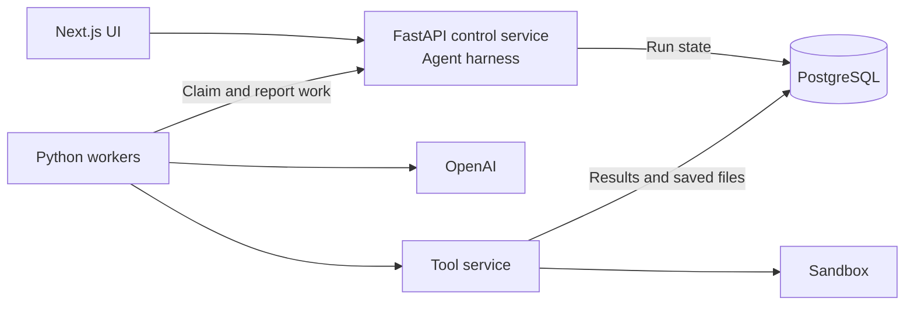
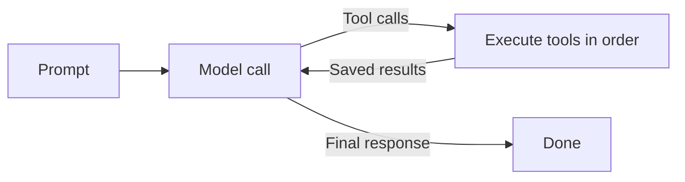

# Durable Agent Runtime Design

## Overall Design

Run agents that write code and edit documents. Each run has a workspace: the files the agent is working on.
A conversation contains ordered runs, one per user prompt. Follow-ups reuse accepted
history and saved files; only one run can be active in a conversation.
Branch from a completed model/tool round to try a new instruction with its saved
history and files. The original conversation continues independently.

After each tool call, save its result and workspace together. If the sandbox crashes, restore the last saved workspace and retry the interrupted call. Completed calls are reused.

## Architecture



- **Control:** decides what runs next and saves agent progress.
- **Workers:** execute assigned model or tool calls.
- **Tools:** run commands and manage workspace recovery.
- **UI:** submit runs; show results, saved files, and failures.

Different runs can execute concurrently. Calls within a run execute in order.

#### Agent Harness

The harness lives inside control. It chooses the next operation from the saved conversation and tool results.



Its interface is `start(config, prompt)` and `advance(state, result)`. Both return the next operation, a final answer, or an error. The harness validates tool calls and limits turns. It has no I/O; workers handle external calls.

#### Tools and Workspaces

Start with four tools: `list_files`, `read_file`, `write_file`, and `run_command`.

A shared runner handles each call:

1. Restore its saved input workspace.
2. Run the tool in a private sandbox.
3. Save the result and updated workspace in one database transaction.
4. Return the result so the agent can continue.

Store full workspace copies in PostgreSQL initially. Tools do not need to declare which files they changed.

| What happened? | What happens next? |
| --- | --- |
| Tool completed and was saved | Reuse its result and files. |
| Sandbox crashed before saving | Retry that call from its saved input. |
| Command reached its time limit and stopped | Discard its changes; let the agent split the work or choose a longer limit. |
| Tests ran and failed | Save the output and files; let the agent fix the code. |

Only files survive a restart. Recreate the environment from a fixed container image.
Split long workflows into separate tool calls to save progress between steps. Commands
do not checkpoint while running.

#### Runtime Recovery

Control gives each attempt a lease: a time limit to report progress. When it expires, another worker can recover the operation. Late results from the old attempt are rejected.

Saving an accepted result and scheduling the next operation happen in one transaction. Duplicate reports cannot advance a run twice.

A model response lost before it is saved may require another OpenAI request.

Pause prevents new worker claims; the current call may finish and save normally.
The pause request survives restarts. Resume clears it without changing the pending
operation, retry timing, or attempt budget. A paused run still occupies its conversation.

#### Scope

Use Docker Compose and OpenAI. For the first version:

- Copy a configured local folder once; start empty if none is configured.
- Run Python 3.12 and pytest offline. Support code, plain text, and Markdown.
- Defer uploads, Git cloning, and external writes such as email or Google Docs updates.

## Implementation Reference

<details>
<summary>Tables and constraints</summary>

Six tables in one PostgreSQL database. Control owns `conversations`, `runs`, `operations`, and `attempts`; tools own `tool_requests` and `workspace_versions`. Use SQLAlchemy ORM with the psycopg 3 driver and Alembic migrations. Shared models live in `db/models.py`; each service owns its queries and explicit transactions. `?` means nullable.

**`conversations`** — Groups ordered runs. `id: uuid` is the primary key;
`created_at: timestamptz` records creation. `forked_from_operation_id: uuid?` links
a branch to its source operation. Derive the title from the first prompt
and status from the latest run. Existing runs keep their IDs and become one-turn conversations.

**`runs`** — One user prompt, its execution, and current lease.

| Column | Type | Purpose |
| --- | --- | --- |
| `id` | `uuid` | Primary key. |
| `conversation_id` | `uuid` | FK to conversations. |
| `turn_index` | `integer` | Zero-based order within the conversation. |
| `submission_key` | `uuid` | Unique browser submission key. |
| `prompt` | `text` | Initial prompt. |
| `config` | `jsonb` | Frozen model/parameters, tool schemas, image digest, seed version ID, and limits. |
| `status` | `text` | queued, running, retrying, succeeded, failed. |
| `pause_requested` | `boolean` | Blocks new claims; defaults false and clears on completion/failure. |
| `next_attempt_at` | `timestamptz?` | Next eligible claim time. |
| `lease_owner` | `uuid?` | Worker process ID. |
| `lease_generation` | `bigint` | Increments on each claim. |
| `lease_expires_at` | `timestamptz?` | Lease deadline. |
| `last_heartbeat_at` | `timestamptz?` | Last renewal. |
| `terminal_error` | `jsonb?` | Failure code/message. |
| `created_at` | `timestamptz` | Creation time. |
| `finished_at` | `timestamptz?` | Terminal time. |

**`operations`** — One logical model or tool call; retries reuse its ID.

| Column | Type | Purpose |
| --- | --- | --- |
| `id` | `uuid` | Primary key; stable tool operation key. |
| `run_id` | `uuid` | FK to runs. |
| `position` | `integer` | Order within the run. |
| `kind` | `text` | model or tool. |
| `request` | `jsonb` | Immutable input; tools include name, arguments, call ID, and input version ID. |
| `result` | `jsonb?` | Accepted output; model context or tool workspace version as applicable. |
| `created_at` | `timestamptz` | Planning time. |
| `completed_at` | `timestamptz?` | Acceptance time. |

**`attempts`** — One execution attempt.

| Column | Type | Purpose |
| --- | --- | --- |
| `id` | `uuid` | Primary key. |
| `operation_id` | `uuid` | FK to operations. |
| `attempt_no` | `integer` | Starts at 1 per operation. |
| `worker_id` | `uuid` | Worker process ID. |
| `lease_generation` | `bigint` | Generation assigned at claim. |
| `status` | `text` | running, accepted, error, unknown. Unknown means no conclusive report. |
| `started_at` | `timestamptz` | Claim time. |
| `finished_at` | `timestamptz?` | Report or expiry time. |
| `error` | `jsonb?` | Code, message, retryability, retry delay. |
| `provider_request_id` | `text?` | OpenAI request ID. |
| `usage` | `jsonb?` | Reported tokens; null means unknown. |

**`tool_requests`** — Deduplication and workspace publication, separate from runtime acceptance.

| Column | Type | Purpose |
| --- | --- | --- |
| `operation_key` | `uuid` | Primary key from caller; no runtime FK. |
| `request` | `jsonb` | Immutable tool name, arguments, and execution configuration. |
| `input_version_id` | `uuid` | FK to workspace_versions. |
| `lease_generation` | `bigint` | Highest registered generation; fences publication. |
| `result` | `jsonb?` | Original completed output. |
| `output_version_id` | `uuid?` | FK to workspace_versions; may equal input for reads. |
| `created_at` | `timestamptz` | Registration time. |
| `completed_at` | `timestamptz?` | Tool commit time. |

**`workspace_versions`** — Immutable, complete workspace checkpoints.

| Column | Type | Purpose |
| --- | --- | --- |
| `id` | `uuid` | Primary key. |
| `archive` | `bytea` | Compressed files/directories and permissions. |
| `created_at` | `timestamptz` | Checkpoint time. |

**Constraints**

- Unique submission key, `(conversation_id, turn_index)`, `(run_id, position)`, and `(operation_id, attempt_no)`.
- At most one queued, running, or retrying run per conversation.
- At most one running or accepted attempt per operation, enforced by a partial unique index.
- Operation result/completion fields are both set or both null. Tool result/output-version/completion fields are all set or all null. Accepted results and workspace archives are immutable.
- Lock the run for claims, acceptance, and expiry recovery. Only running runs have a lease; only queued/retrying runs have a claim time; only terminal runs have a finished_at. Check status/kind values.
- Index claim times and lease expiry. Derive transcript, current operation, workspace version, retry counts, and UI history from saved rows. No events table.

</details>

<details>
<summary>Execution, storage, and limits</summary>

### Execution details

- Save the full model response and planned tool calls. Create one operation at a time, using the latest accepted workspace version. Keep its inputs fixed across retries.
- Give each operation a stable ID. Repeated submissions with different inputs conflict; matching completed requests return the original result.
- Workers heartbeat while executing. Control locks the run when claiming work, accepting a result, or recovering an expired lease.
- Accept new results only from the current, unexpired lease. Save the result, next operation, and run status in one transaction. A repeated accepted report does not advance twice.
- The tool runner registers each attempt's generation and checks it before committing. Once a newer attempt registers, the older attempt cannot save changes.
- OpenAI uses the Responses API without streaming or SDK retries. Preserve response items and tool-call IDs. Control owns retry delays; exhausted retries or permanent errors fail the run.
- Database outages stop new assignments and progress commits. Restart unfinished runs with the same application build.
- Missing files and normal command failures return to the model. Infrastructure failures retry; invalid calls/configuration and exhausted retries fail the run. Shared payloads are specified in `docs/API.md`.

### Workspace storage

- Import `WORKSPACE_INPUT_DIR` once at tool-service startup; unset means empty. Invalid configured paths fail startup. Keep the source folder read-only. Restart tools and control to import changed files; existing runs keep their saved version.
- Store complete compressed copies of `/workspace` in PostgreSQL. Capture files, directories, additions, deletions, and executable permissions. Keep saved versions and tool results indefinitely for now.
- Stop child processes before capturing files. Read-only calls reuse the input version.
- Use a fixed image with Python 3.12, pytest 9.1.1, and `/bin/sh`. Install dependencies when building the image and freeze its digest per run. Each attempt gets a private workspace and temporary storage.
- Run containers as non-root with resource limits. Keep the network, service credentials, host directories, and Docker socket inaccessible to tool code.
- Reject invalid archive paths, links, special files, and oversized checkpoints. The runner enforces command timeouts and removes abandoned containers.

### Defaults

| Setting | Value |
| --- | --- |
| Attempts per operation | 5 |
| Lease / heartbeat | 30 seconds / 5 seconds |
| Command runtime | Agent selects 1–900 seconds; default 120 |
| Fixed attempt deadline | Command budget + 30 seconds for setup and saving results; other calls 120 seconds. Heartbeats cannot extend it. |
| Model turns / output tokens | 20 / 4,096 |
| Workspace / returned logs | 20 MiB uncompressed / 64 KiB |
| Idle worker polling | 1 second |

</details>

<details>
<summary>Repo ownership and local development</summary>

`frontend/` is a pnpm project; `backend/` is a uv project. Each owns its dependencies and lockfile.

```text
durable-agent/
├── frontend/                    # Next.js UI
├── backend/
│   ├── src/durable_agent/
│   │   ├── control/             # APIs, scheduling, runtime persistence
│   │   ├── harness/             # Pure agent transitions
│   │   ├── worker/              # Execution, heartbeats, OpenAI adapter
│   │   ├── tools/               # Tools, runner, workspace store
│   │   ├── db/                  # SQLAlchemy models and sessions
│   │   └── contracts.py         # Shared payloads
│   ├── migrations/
│   └── tests/
├── contracts/                   # Generated OpenAPI
├── docs/                        # API details and file ownership
├── docker/
├── scripts/
└── compose.yaml
```

One owner per component and its tests. Integration owns contracts/generated types, database migrations, dependencies, Compose, and cross-service tests. See `docs/PARALLEL_WORK.md` and `docs/API.md` for implementation boundaries and pending scaffold changes.

Compose runs the frontend, control, tools, two workers, and PostgreSQL. Backend services share a Python base image; Tools also includes the Docker CLI. Keep PostgreSQL in a named volume. Services restart unless stopped; migrations run once. Wait for database health, migrations, and API readiness before workers start.

```bash
./scripts/dev-up.sh
```

The UI is at `localhost:3000`; Next.js proxies public API calls. The trusted tool runner launches sandbox containers.

</details>

<details>
<summary>Failure tests</summary>

Test with PostgreSQL and real service processes; inject failures at commit boundaries.

| Failure | Expected recovery |
| --- | --- |
| Concurrent claims or stale reports | One accepted result; stale reports rejected. |
| Sandbox crashes during an edit | Restore the input version and repeat only that operation. |
| Files saved, but tool response lost | Return the same saved result and workspace version. |
| Old sandbox finishes after a newer attempt registers | Reject its publication. |
| Normal command exits with failing tests | Save the result and files; let the agent continue. |
| Control crashes during acceptance or loses its acknowledgment | All-or-nothing progress; repeated reports do not advance twice. |
| Database outage or worker exit | Resume saved state and recover expired leases within budget. |
| Call stalls while heartbeating | Fixed deadline ends the attempt. |
| Sandbox replaced between calls | Restore exact saved files, including additions, deletions, and permissions. |
| Model response lost before persistence | Inference may repeat; only the accepted tool plan executes. |

</details>
